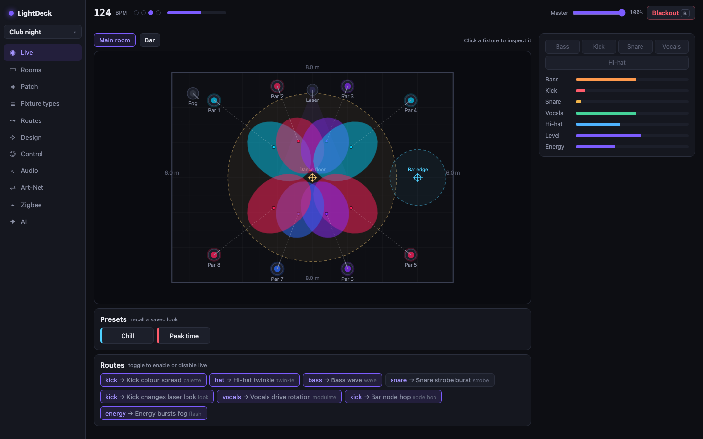
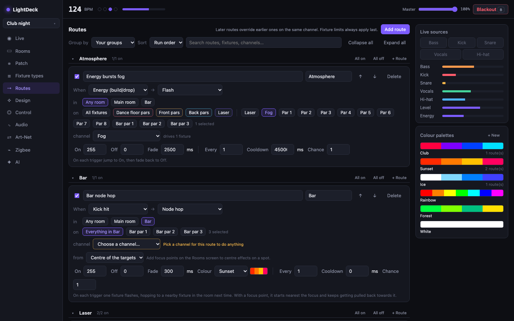
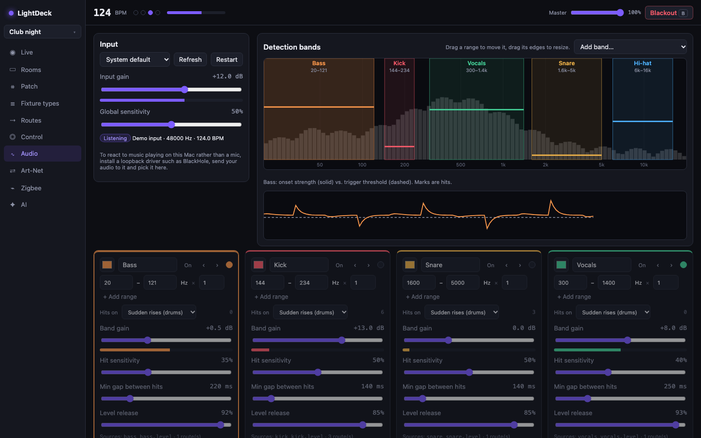
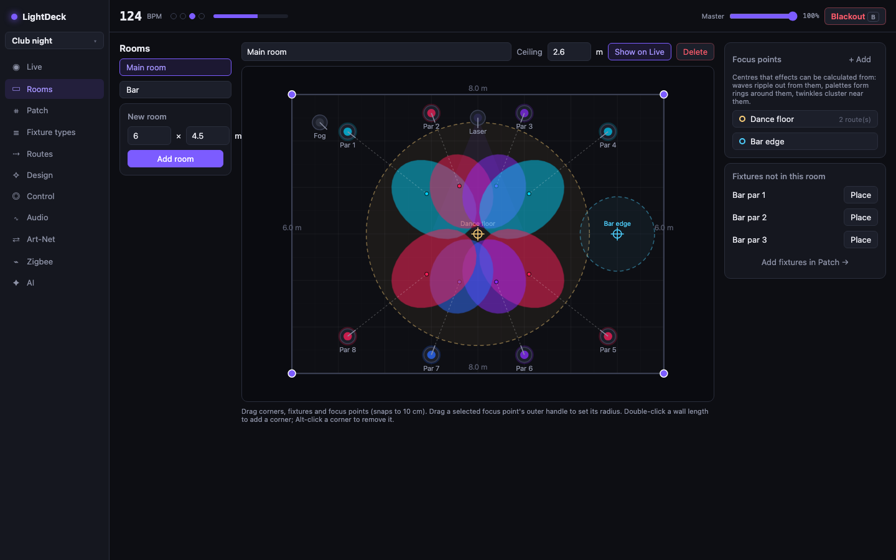
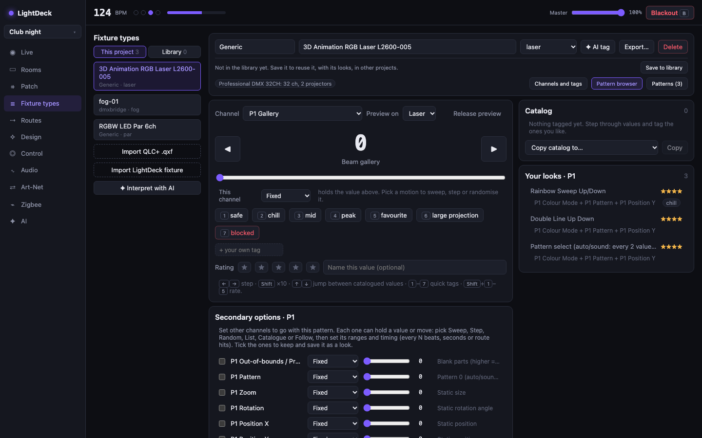
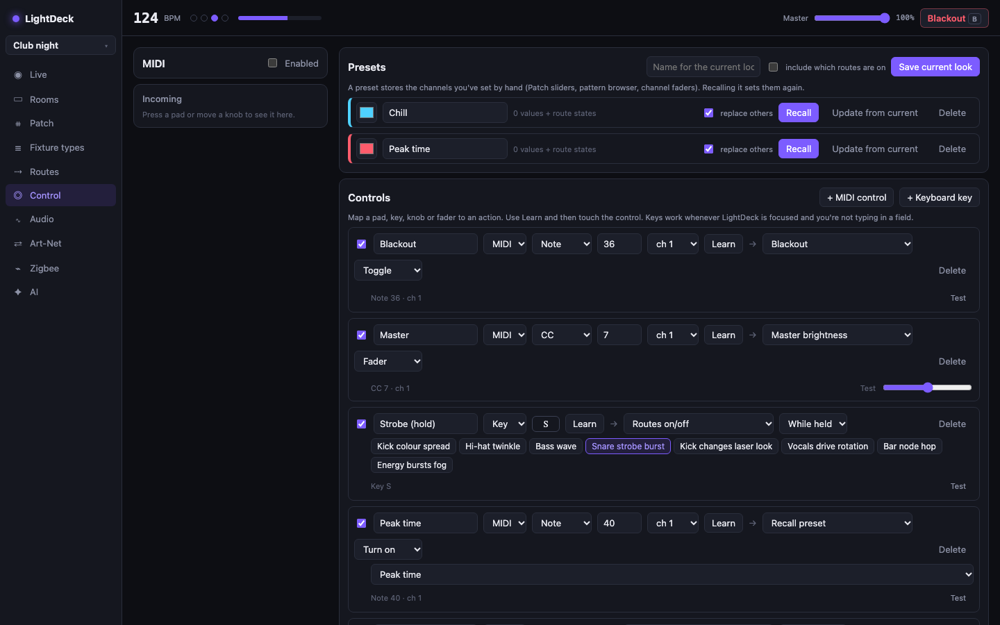

# LightDeck

<!-- Replace sagostin with your GitHub user or organisation once the repository is on GitHub. -->
[](https://github.com/sagostin/lightdeck/actions/workflows/ci.yml)
[](https://github.com/sagostin/lightdeck/actions/workflows/release.yml)
[](https://github.com/sagostin/lightdeck/releases/latest)


An audio-reactive lighting controller for macOS. LightDeck listens to music, detects kicks, snares, hi-hats, bass and vocals, and drives DMX fixtures over Art-Net and Zigbee lights in time with it. You lay fixtures out in your rooms, connect what it hears to what the lights do with **routes**, and play it live from MIDI controllers or the keyboard.

Built with [Tauri 2](https://tauri.app) (Rust engine) and Svelte 5 (UI). Developed and tested on macOS; Windows and Linux builds are produced too.



## What it does

- **Fixtures:** import QLC+ `.qxf` fixture files, or paste any manual's DMX chart and have an AI model convert it. Tag individual values and ranges ("blocked", "safe", "peak"…), and browse a laser's patterns on the real device to build a catalogue of the looks you like.
- **Two-head lasers:** fixtures with several projectors (P1/P2) show and route each head separately.
- **Rooms and layout:** draw rooms to scale, place fixtures with height and direction, use several rooms per project, and add **focus points** (DJ booth, dance floor) that effects ripple out from, rotate around or fade with distance from.
- **Audio detection:** configurable bands on a live spectrum (Kick, Bass, Snare, Vocals, Hi-hat by default; add your own). A band can listen to several frequency ranges, and each has its own gain, sensitivity and detection mode. LightDeck also tracks BPM and the beat.
- **Routes:** connect a sound (a hit or a level) to an action on fixtures.
  - Channel actions: flash, random value from your catalogue, node hop (nearest neighbour in 3D), modulate, cycle.
  - Effects: strobe, colour palette, twinkle, wave. These drive each fixture's brightness and colour automatically.
  - Targets are picked room first, then groups or devices, then channel.
- **Limits that always apply:** lock values, clamp ranges, hold times and blocked values keep a laser below a low ceiling and away from its built-in auto/sound modes, whatever the routes do.
- **Live control:** MIDI and keyboard mappings with Learn, saved presets, a master brightness fader and blackout.
- **Outputs:** Art-Net to any node (e.g. PKnight). Zigbee lights work either through a USB dongle, with LightDeck as the coordinator (no hub or MQTT needed), or through an existing Zigbee2MQTT setup.
- **Projects:** `.lightdeck` project files, autosave, and export/import of app settings.

## Screenshots

| | |
|---|---|
| [](docs/images/routes.png) **Routes** connect hits and levels to channel actions and effects, grouped and targeted by room, group or device. | [](docs/images/audio.png) **Audio** detection bands drawn on a live spectrum, with an onset trace for tuning hits. |
| [](docs/images/rooms.png) **Rooms** drawn to scale, with fixtures, beam directions and focus points. | [](docs/images/browser.png) **Pattern browser** steps through a laser's values on the real device so you can tag, rate and save looks. |
| [](docs/images/control.png) **Control** maps MIDI pads, faders and keys to routes, presets, master and blackout. | |

Screenshots use the built-in demo show (see [Development](#development)).

## Download

Installers for macOS (Apple Silicon and Intel), Windows and Linux are on the [Releases](https://github.com/sagostin/lightdeck/releases) page. Builds aren't notarized: the first time you open LightDeck on macOS, click **Open Anyway** in *System Settings → Privacy & Security*. See [Building and releasing](docs/releasing.md#unsigned-builds).

## Quick start

You need macOS with Xcode Command Line Tools, Rust, and Node.js 20+.

```bash
brew install rustup node
rustup default stable
```

Install the dependencies (once):

```bash
cd ~/Projects/lightdeck && npm install && (cd zigbee-helper && npm install)
```

Run the app in development mode:

```bash
npx tauri dev
```

On first launch LightDeck opens a starter show with the bundled laser and fog fixtures patched and the Art-Net output **disabled**, so nothing is sent until you set your node's IP. See [Getting started](docs/getting-started.md) for a first-show walkthrough.

To build a release app with the Zigbee helper and a Node.js runtime bundled:

```bash
npm run release:build
```

Pushing a `v*` tag to GitHub builds macOS, Windows and Linux installers automatically. See [Building and releasing](docs/releasing.md).

## Documentation

| Guide | What's in it |
|---|---|
| [Getting started](docs/getting-started.md) | Install, first launch, connecting a node, a first audio-reactive route |
| [Fixture types](docs/fixtures.md) | Importing QLC+ files, AI interpretation, tags, the pattern browser, laser safety and ceiling limits |
| [Rooms, patch and groups](docs/rooms-and-patch.md) | Drawing rooms, patching fixtures, limits, fixture groups, Art-Net outputs |
| [Audio detection](docs/audio.md) | Input and gain, detection bands, tuning hits, BPM |
| [Routes and effects](docs/routes.md) | Sources, actions, effects, palettes, targets, grouping |
| [Live control](docs/control.md) | MIDI and keyboard mappings, presets, master, blackout |
| [Zigbee lights](docs/zigbee.md) | USB dongle coordinator, pairing, Zigbee2MQTT mode, limits |
| [Projects and settings](docs/projects-and-settings.md) | Project files, autosave, settings export, where data lives |
| [Troubleshooting](docs/troubleshooting.md) | Common problems and fixes |
| [Building and releasing](docs/releasing.md) | Local release builds, GitHub Actions CI and releases, versioning, signing |
| [Architecture](docs/architecture.md) | For developers: code layout, engine, data model, helper protocol, tests |

## Keyboard shortcuts

| Key | Action |
|---|---|
| `B` | Toggle blackout (unless you've mapped B to something else) |
| `⌘S` / `⇧⌘S` | Save / Save as |
| `⌘O` | Open project |
| Pattern browser: `←` `→` (`⇧` ×10), `↑` `↓`, `1`–`7`, `⇧1`–`⇧5` | Step values, jump between catalogued values, toggle tags, rate |

Any other key can be mapped to an action on the **Control** screen.

## Development

```bash
npm run check                          # type-check the UI
npm test                               # Rust: engine, importer, Zigbee, MIDI and effect tests
```

With the dev server running (`npm run dev` or `npx tauri dev`), open the UI in a normal browser to work on screens without hardware:

- <http://localhost:1420/> uses a copy of a real show with a fake backend.
- <http://localhost:1420/?demo> loads the demo club show (eight pars, laser, fog, two rooms) with a simulated 124 BPM audio feed. Add `&view=routes` (or `rooms`, `audio`, `control`, `library&tab=browser`…) to open a screen directly.
- `npm run screenshots` regenerates the images in `docs/images/` from the demo (needs Google Chrome).

See [Architecture](docs/architecture.md) for how the pieces fit together.

## Safety

Lasers can damage eyes. Keep beams above head height or below the audience, use the fixture limits to lock the laser into DMX manual mode and inside a calibrated safe area, and keep a blackout within reach (the `B` key, or map one to a MIDI pad). For fog, keep routes short (a flash with a short fade, plus a cooldown) and avoid long continuous bursts near smoke alarms.
